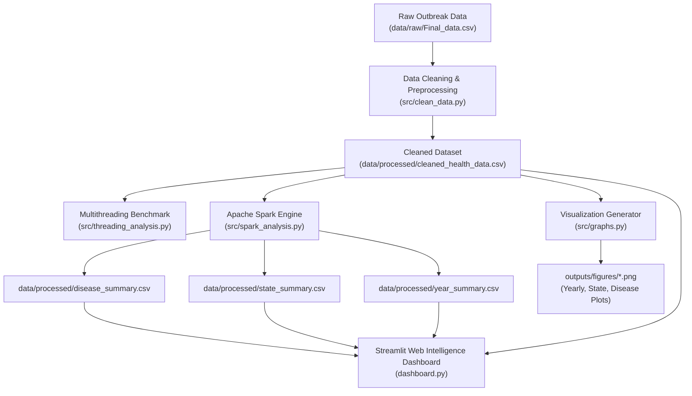

# 🏥 Public Health Outbreak Monitoring & Distributed Analytics

[](https://www.python.org/)
[](https://spark.apache.org/)
[](https://streamlit.io/)
[](https://plotly.com/)
[](https://pandas.pydata.org/)
[](LICENSE)

An end-to-end data engineering and epidemiological surveillance platform designed for **Parallel and Distributed Systems (PDS)**. This project analyzes infectious disease outbreak data across Indian states and union territories, integrating **multithreaded execution**, **distributed big data processing with Apache Spark**, **publication-ready visualizations**, and an **interactive Streamlit web intelligence dashboard**.

---

## 📑 Table of Contents

- [Overview](#-overview)
- [Key Features & Parallel Paradigms](#-key-features--parallel-paradigms)
- [System Architecture](#-system-architecture)
- [Project Directory Structure](#-project-directory-structure)
- [Dataset Details](#-dataset-details)
- [Installation & Environment Setup](#-installation--environment-setup)
- [Pipeline Execution Guide](#-pipeline-execution-guide)
- [Interactive Dashboard](#-interactive-dashboard)
- [Performance Benchmarking](#-performance-benchmarking)
- [License](#-license)

---

## 🌟 Overview

The **Public Health Outbreak Monitoring & Distributed Analytics** platform ingests surveillance records spanning multiple disease categories (e.g., Acute Diarrhoeal Disease, Malaria, Dengue, Chikungunya, Hepatitis) along with geospatial coordinates and environmental metrics (precipitation, leaf area index, temperature).

The platform addresses two core computing challenges:
1. **Parallel Computing**: Accelerating multiple independent analytical queries concurrently using thread pooling.
2. **Distributed Data Processing**: Managing large-scale distributed aggregations, multi-dimensional rollups, and summary metrics via Apache Spark.

---

## ⚙️ Key Features & Parallel Paradigms

| Paradigm / Component | Technology | Target Task | Scalability Rationale |
| :--- | :--- | :--- | :--- |
| **Multithreading** | `concurrent.futures.ThreadPoolExecutor` | Independent disease, state, and annual aggregations | Evaluates parallel vs. sequential execution time and speedup ($S = T_{\text{seq}} / T_{\text{par}}$). |
| **Distributed Big Data** | `Apache Spark / PySpark` | Distributed rollups, grouping, and aggregations | Eliminates single-node RAM bottlenecks via partition-level distributed operations. |
| **Data Ingestion & Cleaning** | `Pandas` | Deduplication, type coercion, and median imputation | Guarantees downstream analytical reproducibility and data hygiene. |
| **Interactive Dashboard** | `Streamlit` & `Plotly` | Web UI for trend exploration and benchmark sandbox | Real-time filtering, dynamic maps, time-series smoothing, and CSV data export. |
| **Visual Reporting** | `Matplotlib` | Publication-ready visual charts | High-resolution figures for reports and documentation. |

---

## 🏛️ System Architecture



---

## 📁 Project Directory Structure

```text
Health/
├── data/
│   ├── raw/
│   │   └── Final_data.csv              # Original unedited raw surveillance dataset
│   └── processed/
│       ├── cleaned_health_data.csv     # Preprocessed and normalized records
│       ├── disease_summary.csv         # Disease-wise cases, deaths, and record counts
│       ├── state_summary.csv           # State/UT outbreak aggregated totals
│       └── year_summary.csv            # Annual case totals and averages
├── outputs/
│   └── figures/
│       ├── disease_cases.png           # Top 10 diseases horizontal bar chart
│       ├── state_cases.png             # Top 10 affected states/UTs bar chart
│       └── yearly_cases.png            # Multi-year outbreak trend line plot
├── src/
│   ├── __init__.py                     # Package initialization
│   ├── clean_data.py                   # Data ingestion, cleaning & deduplication
│   ├── graphs.py                       # Matplotlib publication chart generator
│   ├── spark_analysis.py               # Apache Spark distributed aggregation pipeline
│   └── threading_analysis.py           # ThreadPool vs Sequential performance benchmarking
├── .gitignore                          # Comprehensive Git exclusion rules
├── dashboard.py                        # Streamlit interactive public health web dashboard
├── main.py                             # Unified CLI pipeline orchestrator
├── README.md                           # Complete project documentation
└── requirements.txt                    # Project dependencies
```

---

## 📊 Dataset Details

The dataset represents epidemiological outbreak data collected across Indian districts and states:

- **Total Records:** 8,980+ observation rows
- **Key Columns:**
  - `week_of_outbreak`: Reporting epidemiological week.
  - `state_ut`: State or Union Territory name.
  - `district`: District identifier.
  - `Disease`: Clinical condition name (e.g., Acute Diarrhoeal Disease, Malaria, Dengue).
  - `Cases`: Total reported case counts.
  - `Deaths`: Total reported fatalities.
  - `day`, `mon`, `year`: Temporal timestamp coordinates.
  - `Latitude`, `Longitude`: Geospatial coordinates.
  - `preci`: Precipitation level.
  - `LAI`: Leaf Area Index.
  - `Temp`: Temperature (in Kelvin).

### Data Preprocessing Rules
- Extraneous index columns (`Unnamed: 0`) are removed.
- Duplicate rows are eliminated.
- String numeric fields are safely parsed to numeric formats with error handling.
- Missing climate values (`preci`, `LAI`, `Temp`) are imputed using column-wise medians.
- Processed output is saved to [`data/processed/cleaned_health_data.csv`](data/processed/cleaned_health_data.csv).

---

## 🚀 Installation & Environment Setup

### 1. Prerequisites
- **Python 3.10+**
- **Java JDK 11 or 17** (Required by Apache Spark; ensure `JAVA_HOME` is configured)

### 2. Clone and Setup Environment

```powershell
# Navigate to the project directory
cd d:\college\7\Health

# Create a virtual environment
python -m venv .venv

# Activate virtual environment
# On Windows (PowerShell):
.\.venv\Scripts\Activate.ps1
# On Linux/macOS:
# source .venv/bin/activate

# Install required dependencies
pip install -r requirements.txt
```

---

## 💻 Pipeline Execution Guide

The platform includes a master orchestrator (`main.py`) as well as standalone modular scripts in `src/`.

### 1. Unified Master Pipeline Runner

Run the entire end-to-end workflow in one command:

```powershell
python main.py
```

*This executes: Data Cleaning $\rightarrow$ Multithreading Benchmark $\rightarrow$ Apache Spark Analysis $\rightarrow$ Graph Generation.*

### 2. Selective Execution via CLI Flags

```powershell
# Run only data cleaning
python main.py --clean

# Run only multithreading performance benchmark
python main.py --threading

# Run only Apache Spark distributed analysis
python main.py --spark

# Generate only visualization figures
python main.py --graphs

# Launch the interactive Streamlit dashboard
python main.py --dashboard
```

### 3. Running Individual Modules Directly

Each module in `src/` can also be run independently:

```powershell
# 1. Clean raw data
python src/clean_data.py

# 2. Run multithreading benchmark
python src/threading_analysis.py

# 3. Run PySpark distributed aggregations
python src/spark_analysis.py

# 4. Generate high-resolution figures
python src/graphs.py
```

---

## 🌐 Interactive Dashboard

Launch the rich web intelligence dashboard powered by **Streamlit**:

```powershell
streamlit run dashboard.py
```

### Dashboard Features:
1. **Overview:** High-level metrics showing total cases, fatalities, affected regions, and reporting periods.
2. **Yearly Trends:** Temporal charts showing multi-year infection curves and rolling trends.
3. **Regional Analysis:** State-by-state breakdown with geographical sorting and ranking.
4. **Disease Analysis:** Detailed case-fatality rates and distribution per disease category.
5. **PySpark Benchmark Sandbox:** Live in-browser performance comparison between Pandas and PySpark across customizable sample sizes (25%, 50%, 75%, 100%) and repetitions.
6. **Data Explorer:** Searchable, filterable tabular data browser with instantaneous CSV export.

---

## 📈 Performance Benchmarking

### Multithreading vs Sequential Execution
Evaluated using Python's `concurrent.futures.ThreadPoolExecutor` across independent grouping and aggregation tasks:

```text
PUBLIC HEALTH MULTITHREADING ANALYSIS
-------------------------------------
Disease groups:  131
States analyzed: 35
Years analyzed:  12
Sequential time: 0.007621 seconds
Multithreaded time (3 workers): 0.004118 seconds
Speedup: 1.85x
```

*Note: For CPU-bound tasks in standard Python, thread pooling provides concurrent scheduling. For massive datasets exceeding RAM, PySpark provides horizontal cluster scaling and distributed memory management.*

---

## 📜 License

This project is licensed under the MIT License. See [LICENSE](LICENSE) for details.
